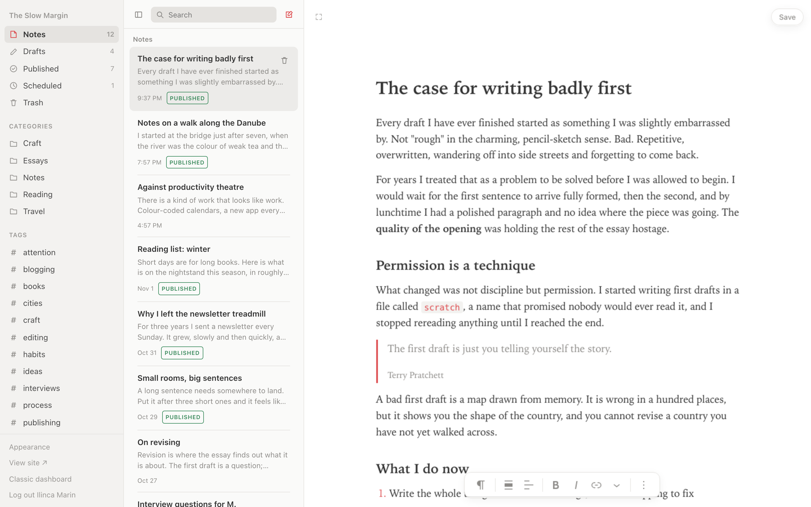
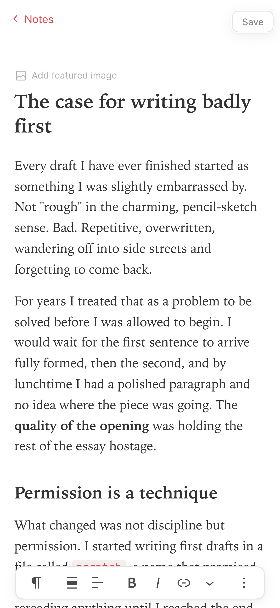

# WordPress for Writers

[](https://playground.wordpress.net/?blueprint-url=https://raw.githubusercontent.com/draganescu/wordpress-for-writers/trunk/blueprint.json)

A WordPress plugin that replaces wp-admin with a calm, three-pane writing app inspired by [Bear](https://bear.app): a library sidebar, a note list, and a distraction-free editor.

It still runs on the block editor, so your posts stay ordinary WordPress posts. The plugin only changes how you get to them and how writing feels.



<p align="center"></p>

## Features

- **Takeover:** writers land in the Writer app instead of the dashboard, both after logging in and when opening `/wp-admin/`.
- **Library sidebar:** Notes, Drafts, Published, Scheduled and Trash with counts, nested categories, and `#tags`.
- **Note list:** title, excerpt, last-modified date and status, plus search and infinite scroll. You can trash, restore or delete permanently from the list.
- **Editor:**
  - It's the real block editor with the wp-admin chrome removed.
  - Theme styles are dropped in favour of a clean default writing surface.
  - The formatting toolbar floats at the bottom, and save/publish sits at the top right.
  - No block inserters or "Type / to choose a block" coaching.
- **Autosave for drafts:** drafts save themselves as you type. Published posts still need an explicit Update.
- **Live titles:** the note list updates as you type a title.
- **Appearance:** 10 themes (System, Red Graphite, Charcoal, Toothpaste, Paper, Solarized Light/Dark, Dracula, Nord, and WordPress in wp-admin's Modern colours), plus font (serif, sans, mono), text size and line width. Choices are saved per user and apply live.
- **Responsive:** on tablets the sidebar becomes a drawer, and on phones you see one pane at a time with back navigation.
- **Focus mode:** hides everything but the editor.

## Try it

The **Try it in WordPress Playground** button opens a disposable WordPress in your browser with the plugin active and a demo blog, "The Slow Margin", already written. Nothing is installed and nothing is saved. The setup lives in `blueprint.json`, and the demo posts in `playground/demo-content.php`.

## Install

Copy or clone this folder into `wp-content/plugins/` and activate **WordPress for Writers**. Requires WordPress 6.5+ and PHP 7.4+.

To reach the classic dashboard, use **Classic dashboard** in the sidebar footer (`/wp-admin/index.php?wfw_classic=1`). The settings sidebar (categories, tags, status, excerpt) opens with **Cmd/Ctrl + Shift + ,**.

Deleting the plugin from the Plugins screen removes each user's appearance preferences (the `wfw_appearance` user meta). Your posts, tags and categories stay, and so do any site global styles set from the app's colour scheme, since they are the site's look.

## Development

There is no build step. Plain PHP, CSS and JavaScript use the `wp.*` globals.

```bash
npm install
npx wp-env start   # http://localhost:8890/wp-admin (admin / password)
npx wp-env stop
```

### Layout

- `wordpress-for-writers.php`: admin takeover, redirects, asset loading, and editor-frame settings (theme styles stripped, canvas CSS injected).
- `includes/appearance.php`: theme palettes, font/size/width options, user meta, and generated CSS tokens.
- `assets/app.js`, `assets/app.css`: the three-pane app.
- `assets/frame.js`, `assets/frame.css`: run inside the embedded block editor. They handle messaging with the app, draft autosave, the fixed bottom toolbar, and theming of the editor UI.
- `assets/editor-content.css`: the default writing surface inside the editor canvas.
- `blueprint.json`, `playground/demo-content.php`: the Playground demo.

## License

GPL-2.0-or-later
