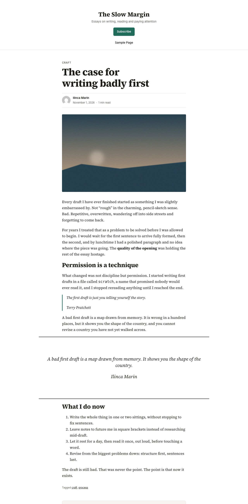
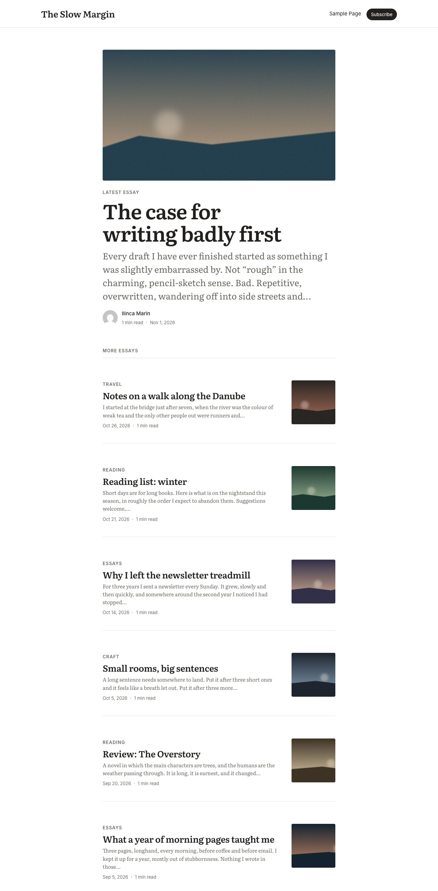
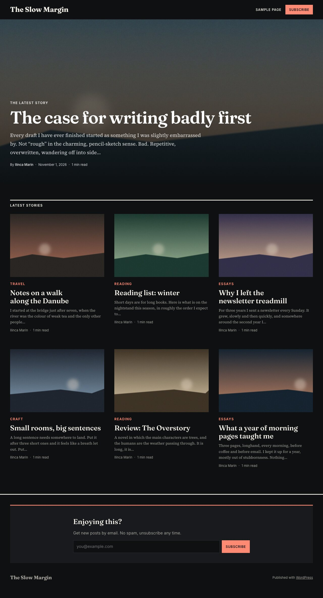

# WordPress for Writers

[](https://playground.wordpress.net/?blueprint-url=https://raw.githubusercontent.com/draganescu/wordpress-for-writers/trunk/blueprint.json)

A WordPress plugin that replaces wp-admin with a calm, three-pane writing app inspired by [Bear](https://bear.app): a library sidebar, a note list, and a distraction-free editor.

It still runs on the block editor, so your posts stay ordinary WordPress posts. The plugin only changes how you get to them and how writing feels.


<p align="center"></p>

## Features

- **Takeover:** writers land in the Writer app instead of the dashboard, both after logging in and when opening `/wp-admin/`.
- **Library sidebar:** Notes, Drafts, Published, Scheduled and Trash with counts, nested categories, and `#tags`. Pin a category or tag from its context menu to add it to the main menu, below the built-in views. Pins are saved per user.
- **Note list:** title, excerpt, last-modified date and status, plus search and infinite scroll. You can trash, restore or delete permanently from the list.
- **Editing now:** open a note in a new tab (from its context menu, or with a Cmd/Ctrl-click or middle click) and it gets an editor of its own inside the app. Open notes are listed as vertical tabs under Editing now, at the top of the sidebar, and each keeps its place and unsaved changes while you switch. Close a tab with its × or a middle click. Open tabs come back after a reload, per device.
- **Context menus:** right-click a note to open it (here or in a new tab), view or preview the post, copy its link or move it to the trash. In the Trash, the menu restores or deletes permanently instead. Right-click a category or tag to pin it to the main menu or view its archive on the site. The context-menu key and Shift+F10 open the same menus from the keyboard. On touch screens a two-finger tap opens them for notes, categories and tags, and a long press also opens a category's or tag's.
- **Editor:**
  - It's the real block editor with the wp-admin chrome removed.
  - Theme styles are dropped in favour of a clean default writing surface.
  - The formatting toolbar floats at the bottom, and save/publish sits at the top right.
  - No block inserters or "Type / to choose a block" coaching.
- **Autosave for drafts:** drafts save themselves as you type. Published posts still need an explicit Update.
- **Live titles:** the note list updates as you type a title.
- **Appearance:** 10 themes (System, Red Graphite, Charcoal, Toothpaste, Paper, Solarized Light/Dark, Dracula, Nord, and WordPress in wp-admin's Modern colours), plus font (serif, sans, mono), text size and line width. Choices are saved per user and apply live.
- **Responsive:** on tablets the sidebar becomes a drawer, and on phones you see one pane at a time with back navigation.
- **Focus mode:** hides everything but the editor.

## Try it

The **Try it in WordPress Playground** button opens a disposable WordPress in your browser with the whole platform set up: the Writer app, both companion plugins, the three themes (Writer Newsletter active), and a demo blog, "The Slow Margin", already written. Nothing is installed and nothing is saved.

The demo comes with an audience too: forty subscribers in various states, three membership tiers, six members, two essays gated part-way through, two members-only posts and a "Become a member" page. Open **Subscribers** or **Members** from the user menu in the Writer sidebar to see them, or log out and read a gated essay to hit the paywall. There's no Stripe account behind the demo, so the tiers' payment links point at the membership page.

The setup lives in `blueprint.json`, the demo posts in `playground/demo-content.php`, and the audience in `playground/demo-audience.php`.

## Install

Copy or clone this folder into `wp-content/plugins/` and activate **WordPress for Writers**. Requires WordPress 6.5+ and PHP 7.4+.

To reach the classic dashboard, use **Classic dashboard** in the sidebar footer (`/wp-admin/index.php?wfw_classic=1`). The settings sidebar (categories, tags, status, excerpt) opens with **Cmd/Ctrl + Shift + ,**.

Deleting the plugin from the Plugins screen removes each user's appearance preferences (the `wfw_appearance` user meta). Your posts, tags and categories stay, and so do any site global styles set from the app's colour scheme, since they are the site's look.

## Companion plugins

These live in `plugins/` and are separate plugins. Install each by copying its folder into `wp-content/plugins/`.

- [Writer Subscribe](plugins/writer-subscribe/README.md): a scroll-triggered subscribe popup, an inline form block, double opt-in and a streamed CSV export that handles very large lists.
- [Writer Members](plugins/writer-members/README.md): membership tiers, a Paywall block and per-post gating (also in feeds and the REST API), with a minimal Stripe webhook for Payment Links.

Companion plugins can add links to the user menu in the Writer sidebar with the `wfw_sidebar_links` filter. Each item is `array( 'label' => '', 'url' => '', 'icon' => '' )`; `icon` is optional and names one of the app's icons.

They can also add a **Visibility** picker to the note's settings with the `wfw_visibility_options` filter (items are `array( 'value' => '', 'label' => '' )`). The choice is saved to the post meta named by `wfw_visibility_meta_key` (default `wmem_tier`), which must be registered with `show_in_rest`. With no options, there is no picker.

## Themes

Three reading themes for the public side of the site live in `themes/`. Each is a standalone block theme (theme.json v3, no build step) that you can zip and install on its own, and none of them needs the plugin.

| Theme | Feel | Home page |
| --- | --- | --- |
| [Writer Newsletter](themes/writer-newsletter/readme.txt) | One narrow column, like an email issue | Dated list of posts |
| [Writer Essay](themes/writer-essay/readme.txt) | Elegant long read with a quiet sans-serif interface, drop cap option and author bio | One featured essay, then a list |
| [Writer Longform](themes/writer-longform/readme.txt) | Magazine feature with a full-bleed hero, chapter headings and wide pull quotes | Lead story cover, then a grid |

Every theme offers the Writer app's ten colour schemes as style variations (System, Red Graphite, Charcoal, Toothpaste, Paper, Solarized Light, Solarized Dark, Dracula, Nord and WordPress), so the public site can match the editor; System follows the reader's light or dark setting. The plugin keeps them in step: when someone who can edit the site's appearance picks a scheme in the Writer app (or activates one of these themes), the site switches to the matching variation. Only the colours change, so fonts, spacing and custom CSS set in the Site Editor stay. Authors' choices only change their own editor. Any block theme can opt in with `add_theme_support( 'wfw-color-schemes' )` and a `styles/<scheme>.json` per scheme; turn the sync off with `add_filter( 'wfw_sync_site_color_scheme', '__return_false' )`. Each theme also has templates for the home page, posts, pages, archives, search and 404, header and footer parts, its own patterns, a reading-time line, and bundled open-licence fonts (Source Serif 4, Literata, Fraunces and Inter, all under the SIL Open Font License).

When the Writer Subscribe plugin is active, the themes add its form after posts and in the footer, plus a Subscribe button in the header. These pieces are patterns that the theme registers only if the `writer-subscribe/form` block exists, so without the plugin they don't render at all. The form picks up the theme's colours through the plugin's `--wsub-*` custom properties.

The Playground demo installs all three and activates Writer Newsletter. Screenshots of each theme in light and dark, at desktop and phone widths, plus a sheet of all ten colour schemes per theme (`*-variations.jpg`), are in `screenshots/themes/`.

<p>



</p>

## Development

There is no build step. Plain PHP, CSS and JavaScript use the `wp.*` globals.

```bash
npm install
npx wp-env start   # http://localhost:8890/wp-admin (admin / password)
npx wp-env stop
```

### Layout

- `wordpress-for-writers.php`: admin takeover, redirects, asset loading, and editor-frame settings (theme styles stripped, canvas CSS injected).
- `includes/appearance.php`: theme palettes, font/size/width options, user meta, and generated CSS tokens.
- `includes/pinned-terms.php`: the user meta for categories and tags pinned to the main menu.
- `includes/site-scheme.php`: applies the chosen colour scheme to themes that support `wfw-color-schemes`.
- `assets/app.js`, `assets/app.css`: the three-pane app.
- `assets/frame.js`, `assets/frame.css`: run inside the embedded block editor. They handle messaging with the app, draft autosave, the fixed bottom toolbar, and theming of the editor UI.
- `assets/editor-content.css`: the default writing surface inside the editor canvas.
- `includes/fonts.php`, `assets/fonts/`: the writing fonts (Geist Serif, Geist Sans, Roboto Mono), self-hosted and registered as default fonts in the site's theme.json data. WordPress loads them in the app, the editor canvas and the front end, and any theme can use them from the font controls in the editor and Styles.
- `blueprint.json`, `playground/demo-content.php`: the Playground demo.
- `themes/`: the three reading themes. wp-env mounts them, so `npx wp-env run cli wp theme activate writer-essay` switches between them.

## Releases

The Writer plugin, each plugin in `plugins/` and each theme in `themes/` ships as its own zip. Each zip unpacks to a folder named after the package, so it installs from **Plugins → Add New → Upload** or **Themes → Add New → Upload** like any other.

```bash
bin/build-zips.sh --list             # packages and their versions
bin/build-zips.sh                    # every zip, into build/
bin/build-zips.sh writer-subscribe   # just one
```

To publish, bump the `Version:` header, then push a tag. The `Release zips` workflow builds the zips and attaches them to a GitHub release.

- `writer-subscribe-v0.2.0` releases one package. The workflow fails if the tag doesn't match the package's `Version:` header.
- `v0.2.0` releases a bundle with every package.
- Running the workflow by hand builds every zip as an artifact, without publishing a release.

Dev files (`node_modules`, `package.json`, `.wp-env.json` and so on) are left out. The Writer plugin's zip also leaves out the `plugins/`, `themes/`, Playground and screenshot folders. To leave out more from one package, add a `.distignore` file to its folder with rsync patterns, one per line.

## License

GPL-2.0-or-later

The bundled fonts are under the SIL Open Font License 1.1, with the licence next to the files: Geist Sans and Geist Serif in `assets/fonts/geist/OFL.txt`, Roboto Mono in `assets/fonts/roboto-mono/OFL.txt`.
